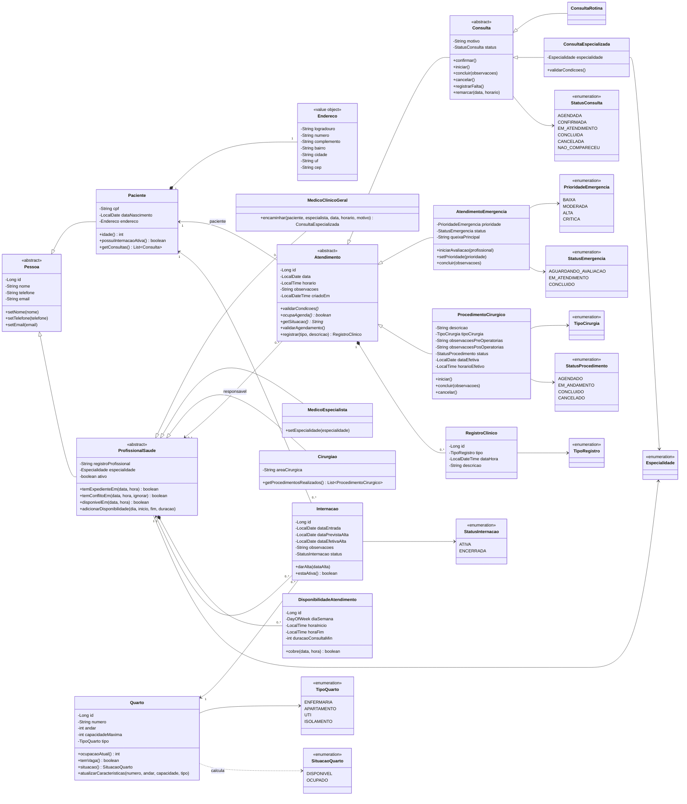

# Diagrama de Classes — Sprint 2

O diagrama representa o modelo de domínio implementado no backend. As camadas de API
(`Controller`, `Service`, `Repository` e DTOs) não aparecem porque não fazem parte do
modelo de domínio.

## Regras representadas

- As modalidades de atendimento reutilizam atributos e comportamentos de `Atendimento`.
- Consultas de rotina e especializadas compartilham o ciclo de estados de `Consulta`.
- Cada categoria concreta de profissional possui responsabilidades próprias.
- Uma emergência pode aguardar avaliação sem profissional; os outros atendimentos exigem responsável.
- Uma internação associa paciente, profissional e quarto e ocupa uma vaga enquanto estiver ativa.
- Endereço pertence ao paciente e registro clínico pertence ao atendimento.
